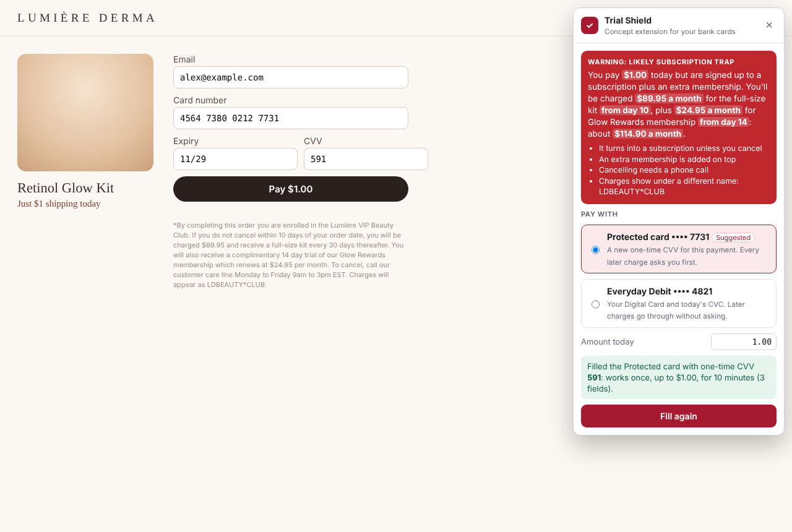
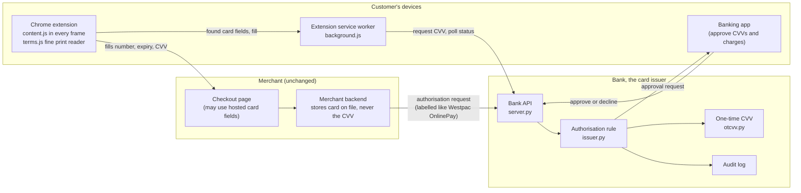
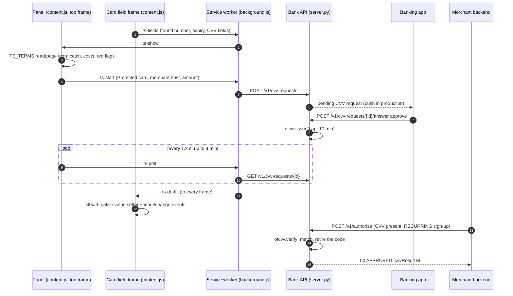
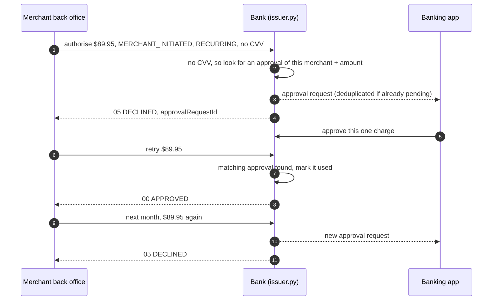
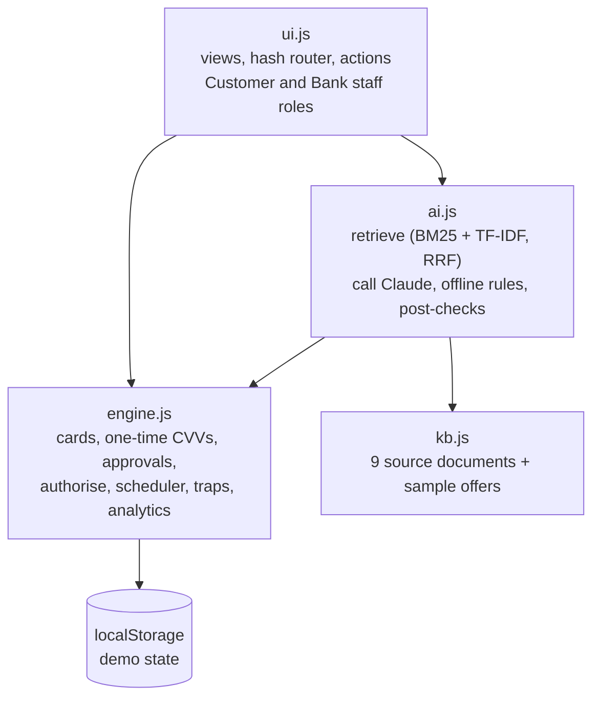
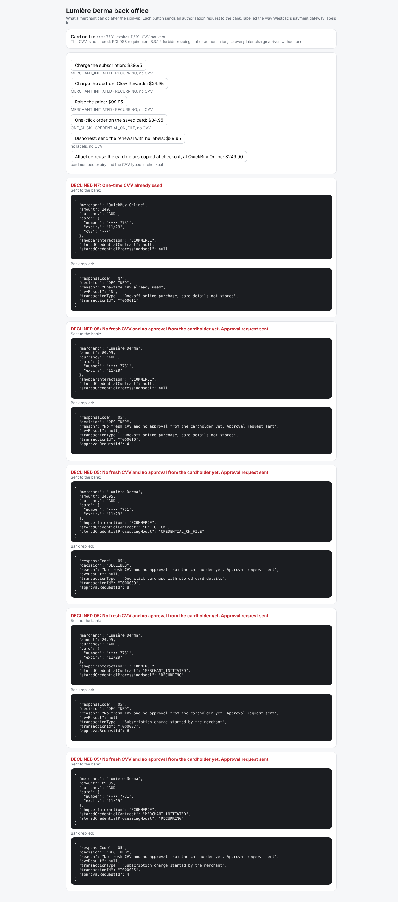

# Trial Shield

**Stop subscription traps before they charge you.**
Bytes and Balance, University of Queensland. Westpac Innovation and Coding Competition 2026 (AI in Banking).

A "$1 today" offer can quietly become $114.90 a month. Trial Shield gives the customer a second card on the same account, the **Protected card**, and one rule:

> **No fresh CVV and no approval from the customer means no payment.**

* **At checkout**, the banking app makes a one-time CVV for that purchase only. It works once, for 10 minutes, up to the amount approved.
* **After that**, every charge the merchant starts asks the customer first: renewals, add-ons, one-click orders, Apple Pay merchant tokens, App Store and PayPal. An approval covers one charge. No answer means decline.
* **A browser extension** reads the fine print at checkout, shows the catch in plain words, suggests the Protected card and fills it in.



Every card number in this repository is made up, so nothing can be charged anywhere.

---

## Contents

1. [Repository structure](#1-repository-structure)
2. [Architecture overview](#2-architecture-overview)
3. [Flow 1: sign-up with a one-time CVV](#3-flow-1-sign-up-with-a-one-time-cvv)
4. [Flow 2: a charge the merchant starts later](#4-flow-2-a-charge-the-merchant-starts-later)
5. [The authorisation rule](#5-the-authorisation-rule)
6. [One-time CVV design](#6-one-time-cvv-design)
7. [Browser extension internals](#7-browser-extension-internals)
8. [Bank service API](#8-bank-service-api)
9. [Merchant simulator](#9-merchant-simulator)
10. [Web prototype architecture](#10-web-prototype-architecture)
11. [Where AI is used, and where it deliberately isn't](#11-where-ai-is-used-and-where-it-deliberately-isnt)
12. [From prototype to production at Westpac](#12-from-prototype-to-production-at-westpac)
13. [Security and privacy by design](#13-security-and-privacy-by-design)
14. [Run it](#14-run-it)
15. [Demo walkthrough](#15-demo-walkthrough)
16. [Tests](#16-tests)
17. [Limitations](#17-limitations)

---

## 1. Repository structure

```
trial-shield/
├── bank/                     The bank side (issuer), Python 3.9+, standard library only
│   ├── otcvv.py              One-time CVV: RFC 4226 HOTP, bound to card, counter, amount cap, expiry
│   ├── issuer.py             Authorisation rule, approval requests, CVV requests, audit log
│   ├── server.py             HTTP servers: bank API + banking app page, two demo shops, hosted card fields
│   └── tests.py              16 tests plus a 100,000 attack brute-force simulation
├── extension/                Chrome extension, Manifest V3, plain JavaScript
│   ├── manifest.json         Permissions, content scripts in all frames, service worker
│   ├── content.js            Card field detection, fine print panel (Shadow DOM), autofill
│   ├── terms.js              Fine print reader (rules, runs on the page)
│   ├── background.js         Service worker: the only part that talks to the bank, relays between frames
│   ├── popup.html, popup.js  Toolbar popup: bank connection status and settings
│   └── icons/
├── web-prototype/            The full app concept: customer banking app and bank staff console
│   ├── index.html
│   ├── css/app.css
│   ├── js/kb.js              Knowledge base (9 documents with sources) and sample offers
│   ├── js/engine.js          Domain and bank simulation: cards, CVVs, approvals, authorisation, scheduler
│   ├── js/ai.js              AI layer: hybrid retrieval, Claude calls, offline rules, post-checks
│   ├── js/ui.js              Views, hash router and actions for both roles
│   └── vendor/               Bootstrap 5.3, Bootstrap Icons, Chart.js (bundled, no CDN)
├── docs/
│   ├── FEASIBILITY.md        Evidence that every piece already runs in production, with sources
│   └── screenshots/          The end-to-end run in Chrome
└── start-demo.command        Double-click on a Mac to start the bank and the shops
```

The repository holds two deliverables that share one design:

| | Feasibility proof (`bank/` + `extension/`) | Web prototype (`web-prototype/`) |
|---|---|---|
| Purpose | Prove the mechanism works with real components | Show the full customer and bank staff experience |
| Runs | Real Chrome extension against a real HTTP bank service | In any browser, no install |
| Card logic | `bank/issuer.py`, `bank/otcvv.py` | `web-prototype/js/engine.js` (same rule, in JavaScript) |
| AI | None. Fine print reading is rules on the page | Claude with retrieval, falling back to rules |

---

## 2. Architecture overview

Four parties take part in a card payment. Trial Shield adds behaviour on the customer's side (extension, banking app) and the issuer's side (the bank), and needs **no change from merchants or card networks**.



| Component | File | Responsibility |
|---|---|---|
| Content script | `extension/content.js` | Runs in every frame. Finds card fields, reads the fine print, shows the panel (top frame), fills fields (any frame) |
| Fine print reader | `extension/terms.js` | Pulls out what you pay today, each recurring amount and when it starts, and the red flags. Runs locally on the page |
| Service worker | `extension/background.js` | The only network caller. Talks to the bank, relays messages between the panel and the payment frames |
| Bank API | `bank/server.py` | HTTP endpoints for the extension, the banking app and merchants' authorisation requests |
| Authorisation rule | `bank/issuer.py` | Decides every charge: one-time CVV check, or the per-charge approval rule |
| One-time CVV | `bank/otcvv.py` | Makes and checks codes. Keeps only counters and bindings, never a list of codes |
| Banking app page | `bank/server.py` (`/app`) | Stands in for the phone: CVV requests, charge approvals, "Stop merchant", audit log |
| Merchant simulator | `bank/server.py` (ports 8801 to 8803) | Two made-up shops and a hosted card field frame, with back offices that send later charges |

---

## 3. Flow 1: sign-up with a one-time CVV



Why it's built this way:
* **Every frame runs the content script.** Payment providers such as Stripe and Shopify put card fields in their own iframe on another origin. Filling inside that frame is the same technique password managers use.
* **Only the service worker calls the bank.** Extension pages with host permissions are not subject to the shop page's CORS or private network rules, so the panel works on any website.
* **The panel lives in a Shadow DOM.** The shop's CSS can't restyle it, and its CSS can't leak into the shop.
* **Polling over messages, not one long call.** Each message wakes the Manifest V3 service worker, so it can't be shut down mid-wait.

---

## 4. Flow 2: a charge the merchant starts later



A bank can't hold a payment open while someone finds their phone, so an unapproved charge is declined straight away. Subscription merchants retry declined charges as a matter of course, so a late approval still lets the retry through. The web prototype also sends the request ahead of a charge it expects (two days before the trial ends), from the fine print read at sign-up.

---

## 5. The authorisation rule

`bank/issuer.py`, `Issuer.authorise()`. The request uses the labels Westpac's own OnlinePay gateway sends with every card payment:

| storedCredentialContract | storedCredentialProcessingModel | Meaning |
|---|---|---|
| (none) | (none) | One-off online purchase |
| (none) | `CREDENTIAL_ON_FILE` | Purchase, shopper agrees to store the card |
| `ONE_CLICK` | `CREDENTIAL_ON_FILE` | One-click purchase with stored details |
| (none) | `RECURRING` | Subscription sign-up |
| `MERCHANT_INITIATED` | `RECURRING` | Subscription charge started by the merchant |
| (none) / `MERCHANT_INITIATED` | `UNSCHEDULED_CREDENTIAL_ON_FILE` | Sign-up for, or a later, unscheduled charge (for example top-ups) |

Decision order for the **Protected card**:

1. Merchant stopped by the cardholder: decline `05`.
2. **CVV present:** verify it as a one-time CVV. If it's live, matches and is under the cap, approve `00` and retire the code. Otherwise decline `N7` (the Visa response code for a CVV2 failure).
3. **No CVV, whatever the labels say:** approve only if the cardholder approved this exact merchant and amount. That approval is then used up. Otherwise decline `05` and send an approval request.

The labels are recorded but **never trusted**. A merchant that strips the labels or calls a renewal a purchase still has no fresh CVV, so it still needs the cardholder. The **Everyday card** in the simulator behaves like cards do today (static CVV, merchant-initiated charges approved) so the two can be compared side by side.

Response shape:
```json
{ "responseCode": "05", "decision": "DECLINED",
  "reason": "No fresh CVV and no approval from the cardholder yet. Approval request sent",
  "cvvResult": null, "transactionType": "Subscription charge started by the merchant",
  "transactionId": "T000005", "approvalRequestId": 4 }
```

---

## 6. One-time CVV design

`bank/otcvv.py`

```
code = HOTP(card_key, counter || SHA-256(card | amount cap in cents | expiry), 3 digits)
```

* **HOTP is RFC 4226.** It's the construction behind authenticator apps and bank security codes. `tests.py` checks the implementation against the RFC's own reference values (Appendix D). The CVV variant uses HMAC-SHA-256 and the RFC's dynamic truncation, cut to 3 digits.
* **Bound to what the customer approved.** The counter only goes up, and the amount cap and expiry are inside the MAC. Changing any of them gives a different code.
* **Nothing secret is stored as a list.** The issuer keeps the per-card key (in production, inside an HSM) and the binding records (counter, cap, expiry, used). It recomputes the code at authorisation and compares in constant time (`hmac.compare_digest`).
* **Single use, 10 minutes.** A code is retired on first success and rejected after expiry. Reasons are reported ("already used", "expired") for explainability.
* **Lockout.** Three wrong CVVs in a row lock card-not-present payments on that card.

| | Static CVV today | One-time CVV |
|---|---|---|
| Details leaked or skimmed | Work until the card is replaced | Worthless once used, and after 10 minutes |
| Guessing | Many tries across many shops unless detected | 3 tries, then locked: measured about 0.3% success, only while a code is live, only up to the approved amount |
| Renewal after a trial | Goes through: renewals never carry a CVV | Needs the cardholder's approval (section 5) |

The one-time CVV protects the moment of sign-up. PCI DSS forbids merchants from keeping the CVV after authorisation, so it can't stop a renewal on its own. **That's why the approval rule exists, and why the two only work together.**

---

## 7. Browser extension internals

**Manifest V3** (`extension/manifest.json`):
* `content_scripts`: `terms.js` and `content.js` on `<all_urls>` with `all_frames: true` and `match_about_blank: true`, so they reach hosted payment iframes.
* `host_permissions: <all_urls>`: needed to read checkout pages anywhere and to call the bank from the service worker.
* `permissions: storage`: the bank address setting.

**content.js runs in four stages:**

1. **Find card fields.** Pass 1 uses the standard `autocomplete` tokens (`cc-number`, `cc-exp`, `cc-exp-month`, `cc-exp-year`, `cc-csc`). Pass 2 falls back to names, ids, placeholders, `aria-label`s and label text. Email, phone and postcode fields are excluded. It only acts if a card number field exists. A `MutationObserver` rescans single-page checkouts as they change.
2. **Read the fine print** (top frame only) with `TS_TERMS.read(document.body.innerText)`. It extracts the upfront price, recurring amounts with their cycles and start days, add-on memberships, phone-only cancellation, a different statement name, short cancel windows and lock-in contracts, then rates the risk and writes the catch line. A high-risk page opens the panel even before a card form appears.
3. **The panel** (top frame, Shadow DOM) shows the catch with amounts and days in bold, the card choice (Protected suggested when risky) and the amount detected on the page. For the Everyday card it warns what will go through.
4. **Fill.** In every frame that has the fields, values are set through the native `HTMLInputElement` value setter, then `input` and `change` events fire, so React, Vue and payment SDK forms register them. Expiry formatting adapts to the field (`MM/YY`, `MM / YY`, `MM/YYYY`, or separate month and year selects).

**Message protocol** (`chrome.runtime` / `chrome.tabs`):

| Message | From → to | Purpose |
|---|---|---|
| `ts-fields` | any frame → worker | Card fields found here |
| `ts-show` | worker → top frame | Open the panel |
| `ts-start` | panel → worker | Everyday: fill now. Protected: create a CVV request |
| `ts-poll` | panel → worker | Check the request; when approved, the worker sends `ts-do-fill` |
| `ts-do-fill` | worker → every frame | Fill the card details |
| `ts-filled` / `ts-filled-report` | frame → worker → panel | How many fields were filled, and whether in a cross-origin frame |

---

## 8. Bank service API

`bank/server.py`, standard library `ThreadingHTTPServer`, JSON over HTTP. All state sits in one `Issuer` object behind a lock.

| Method | Path | Used by | Does |
|---|---|---|---|
| GET | `/app` | Customer | The banking app page (polls `/v1/state` every 1.5 s) |
| GET | `/v1/state` | Banking app | CVV requests, approvals, audit log, stopped merchants, lock state |
| POST | `/v1/cvv-requests` | Extension | Create a one-time CVV request `{card, merchant, amount}` |
| GET | `/v1/cvv-requests/{id}` | Extension | Status; once approved includes number, expiry, CVV, expiry time |
| POST | `/v1/cvv-requests/{id}/answer` | Banking app | `{approve: true or false}` |
| POST | `/v1/approvals/{id}/answer` | Banking app | `{approve, stop}`: approve one charge, decline, or stop the merchant |
| GET | `/v1/cards/everyday` | Extension | Everyday card details (as the Digital Card shows today) |
| POST | `/v1/authorise` | Merchants | Authorisation request, returns the decision (section 5) |
| POST | `/v1/reset` | Banking app | Reset the demo |

---

## 9. Merchant simulator

Also in `bank/server.py`, so the whole proof runs with one command.

| Port | What | Why it's there |
|---|---|---|
| 8801 | **Lumière Derma**, plain checkout with standard `autocomplete` attributes, $1 today then $89.95 + $24.95 a month | The common checkout pattern and a realistic trap offer |
| 8802 | **StreamMax**, 7 days free then $24.99 a month, card fields in an iframe from port 8803 | Hosted payment fields on another origin, as Stripe or Shopify use |
| 8803 | The hosted card fields, with Shopify-style names and no `autocomplete` attributes | Tests the fallback detection pass |

Each shop's **back office** (`/office`) stores the card number and expiry but **drops the CVV**, as PCI DSS requires. It then sends later charges with real labels: the renewal, an add-on, a price rise, a one-click order, a dishonest renewal with no labels, and an attacker replaying card details copied at checkout. The checkout copies what was typed into `localStorage` purely to simulate a card skimmer for that last test. Every response shows the exact request sent and the bank's reply.

---

## 10. Web prototype architecture

A static single-page app with no build step and no server. It runs from a file, any static host, or a claude.ai artifact.



**Layers**
* **`engine.js` (domain).** A simulated bank with a demo clock. It holds cards and tokens (including Apple Pay merchant tokens), one-time CVVs (10 minutes, single use), approval requests, and `authorise()`, the same rule as `issuer.py` in JavaScript. It also has the sign-up recorder (turns the fine print reading into expected charges), the scheduler (asks ahead, first charges, renewals, retries, expiry of old requests), the merchant test bench (11 traps on both cards), cancellations, disputes, the bank-wide merchant block, a modelled population for the analytics, and an audit log.
* **`ai.js` (AI layer).** Builds 90-word chunks with overlap from `kb.js`, ranks them with BM25 and TF-IDF cosine, and fuses the two with Reciprocal Rank Fusion (k = 60). It sends the top sources plus the user's text to Claude, asking for strict JSON. If no model is available it uses deterministic rules (`extractTerms`, `explainCharge`, templates). Every answer then goes through post-checks (section 11). Every call is written to an AI audit log with mode, latency and sources.
* **`ui.js` (presentation).** A hash router with role separation. Customers can't open staff routes, and the reverse.
  * Customer: `#home`, `#cards`, `#protected`, `#fineprint`, `#shop`, `#activity`, `#txn-{id}`, `#subscriptions`.
  * Bank staff: `#ops`, `#impact`, `#watchlist`, `#disputes`, `#powerbi`.
  * Each customer screen has a side panel mapping it to the Westpac App feature it builds on, with links to Westpac's help pages.
* **State** is a single object saved to `localStorage`, so a reload keeps the demo where it was. **Reset** reseeds it.

---

## 11. Where AI is used, and where it deliberately isn't

A mentor asked whether this could be done without AI. The answer is by design: **money decisions are plain, testable rules; AI does the messy reading.**

| Task | How | Why |
|---|---|---|
| Approve or decline a charge | Rules (`issuer.py`, `engine.js`) | Must be deterministic, auditable and identical for every customer |
| One-time CVV | Cryptography (RFC 4226) | Security, not prediction |
| Read fine print and find the catch | Claude with retrieval (web prototype); rules on the page (extension) | Offer terms are unstructured and written to be missed |
| Explain a cryptic charge (e.g. `APPLE.COM/BILL`) | Claude with retrieval, rules as fallback | Needs context: descriptor, amount, history, known billing names |
| Draft a cancellation message | Claude, template as fallback | Saves the customer time |
| Refunds and disputes | A human banker (disputes queue) | The AI never decides a customer's money |

**Guardrails on every AI answer** (`ai.js`):
* Red flag quotes are highlighted only if the exact words appear in the original text.
* Prices are rounded and validated, and the trial end date is recomputed from the trial length. The model's arithmetic is never trusted.
* Enumerated fields are forced to allowed values (for example risk must be low, medium or high).
* If the model is unavailable or returns bad JSON, the offline rules answer and the audit log records the fallback.
* Only the text the customer pastes is sent to the model, never account data.

The earlier Django build of this idea used LangChain structured output, LangGraph and a hybrid BM25 plus dense retriever; the web prototype is the browser port of that pipeline.

---

## 12. From prototype to production at Westpac

| Prototype | Production equivalent | Already exists at Westpac or in the networks |
|---|---|---|
| `otcvv.py` key in memory | Per-card keys in the issuer's HSM, codes verified in card processing | Westpac already verifies a dynamic CVC that changes every 24 hours on the Digital Card |
| Banking app web page | Westpac App push notification with Face ID | Westpac Protect already sends one-time codes by app notification or SMS |
| Merchant labels in `/v1/authorise` | Stored credential and merchant-initiated indicators in the authorisation message | Westpac OnlinePay already sends these labels; Visa and Mastercard have required them since 2017 |
| Approval matched on merchant + amount | Matched on merchant ID and the network transaction reference | Network transaction IDs link later charges to the original sign-up |
| Wallet tokens in `engine.js` | Apple Pay merchant tokens through the Visa and Mastercard token services | Westpac My Merchants already manages merchant tokens |
| Extension loaded unpacked | Chrome Web Store listing after a security review | Capital One Eno already fills virtual cards at checkout |
| Staff "Block recurring" | Issuer-side merchant block | Westpac NZ already blocks known trap merchants |

**Nothing is required from merchants**: they keep sending the same messages. Customers opt in to the Protected card and keep subscriptions they want on the Everyday card. Sources for every row are in [docs/FEASIBILITY.md](docs/FEASIBILITY.md).

---

## 13. Security and privacy by design

* **Least data off the device.** The extension reads fine print on the page. The page text is never sent anywhere, and only the merchant host and amount go to the bank.
* **No CVV at rest.** Codes are recomputed, not stored. Merchants never receive a reusable CVV.
* **Constant-time comparison** and **lockout** after 3 wrong codes.
* **Fail safe.** No answer, a timeout or an unreachable bank means decline or no fill, never a silent approval.
* **Audit trail.** Every CVV request, issue, approval, decision and AI call is logged with a reason.
* **Human in the loop** for refunds. AI explains; people decide.
* **No impersonation.** The prototype uses an original design, labelled as a concept, and maps to real Westpac App features with links rather than copying Westpac branding.
* The demo server binds to `127.0.0.1` by default; `--lan` opens only the banking app to your local network so a phone can approve.

---

## 14. Run it

### Web prototype (1 minute)
Open `web-prototype/index.html` in Chrome and choose **Customer** or **Bank staff**. As a local file, it uses the offline rules, so no internet or API key is needed.

### Feasibility proof (2 minutes)
You need Python 3.9 or later (no packages) and Google Chrome.

1. **Start the bank and the shops.** On a Mac, double-click `start-demo.command`. Or run:
   ```
   cd bank
   python3 server.py          # add --lan to approve from your phone on the same Wi-Fi
   ```
2. **Load the extension.** Open `chrome://extensions`, turn on **Developer mode**, click **Load unpacked**, and choose the `extension` folder.
3. **Open the banking app** at http://127.0.0.1:8790/app in a window beside the shop.

| Address | What |
|---|---|
| http://127.0.0.1:8790/app | Banking app (approvals) |
| http://localhost:8801/ | Lumière Derma checkout |
| http://localhost:8801/office | Lumière Derma back office |
| http://localhost:8802/ | StreamMax checkout with hosted card fields |

---

## 15. Demo walkthrough

1. **The catch.** Open http://localhost:8801. The panel shows: $1 today, then $89.95 a month from day 10, plus $24.95 a month from day 14, about **$114.90 a month**. It also flags phone-only cancellation and the statement name `LDBEAUTY*CLUB`.
2. **One-time CVV.** Keep **Protected card**, click **Fill card details**, then **Approve with Face ID** in the banking app. The card number, expiry and a fresh CVV fill in.
3. **Works once.** Click **Pay $1.00**: approved. Click it again: **declined N7, one-time CVV already used**.
4. **Later charges.** Open http://localhost:8801/office:
   * **Charge the subscription**: declined `05`, and a request appears in the banking app.
   * **Dishonest renewal with no labels**: still declined.
   * **Attacker reuses the copied card details**: declined `N7`.
5. **One approval, one charge.** Approve the $89.95, then charge twice. The first is approved, and the second asks again.
6. **Hosted card fields.** Open http://localhost:8802, fill, approve and start the trial. The fields inside the other site's frame are filled.
7. **Contrast.** On the checkout, pick **Everyday Debit** to see the warning about what would go through.
8. **Full app.** In the web prototype:
   * Approve the waiting Kayo charge on Home.
   * Get a one-time CVV in **Cards Hub → Protected card**.
   * **Checkout demo → Run all**: the Everyday card loses $932.64, the Protected card $0.00.
   * **Check an offer's fine print** with the skincare example.
   * **Explain** the `APPLE.COM/BILL` charge.
   * As **Bank staff**, block a trap merchant on the watchlist.



---

## 16. Tests

```
cd bank
python3 tests.py
```

| Group | What it checks |
|---|---|
| RFC 4226 | HOTP against the 10 reference values in RFC 4226 Appendix D |
| One-time code | Works once, expires after 10 minutes, respects the amount cap, locks after 3 wrong guesses, codes are spread out |
| Subscription traps | Sign-up, trial conversion, hidden add-on, one-click order, unscheduled top-up, unlabelled renewal, copied details at another shop, one approval covers one charge, price rise asks again, stop merchant. Each runs on both cards |
| Brute force | 100,000 simulated attacks while a code is live: about 0.3% succeed (theory 0.300%) |

---

## 17. Limitations

* Card networks, push notifications, Face ID and Apple Pay are simulated. The shops and all card numbers are made up.
* Tested on two demo shops covering the two common checkout patterns, not on live merchant sites.
* A CVV request carries the merchant's host name as a hint. Binding a code to a specific merchant ID needs a domain to merchant mapping, or binding on first use as Capital One Eno does.
* The web prototype's live AI path runs inside a claude.ai artifact; as a local file it uses the offline rules.
* Bank staff analytics in the web prototype use modelled data.

---

**Disclaimer.** This is a student concept, not a Westpac product. It uses example data, simulated card network calls and made-up shops.
